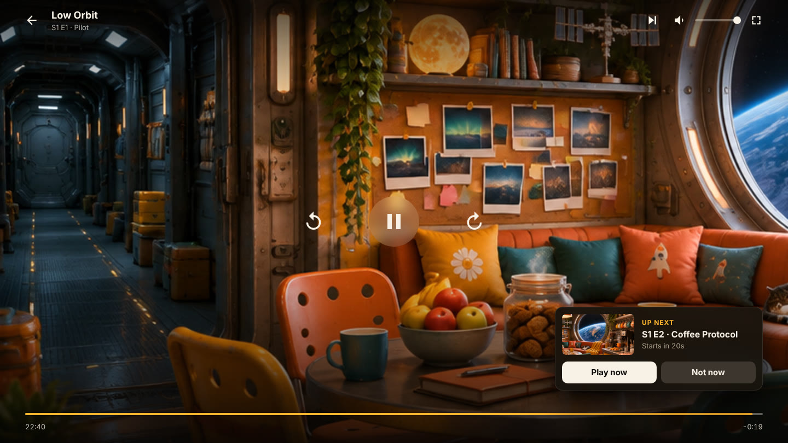

# SunFlix

Your own little streaming site. Point it at a folder of videos and it gives you
a browsable library with a player, in the spirit of Jellyfin and Plex, but small
enough to read in one sitting.




*The titles and artwork in these screenshots are made up for the demo.*

## Run it

You need [Node.js](https://nodejs.org) 18 or newer and [ffmpeg](https://ffmpeg.org)
(which includes `ffprobe`). There is nothing to `npm install`.

```bash
node server.js /path/to/movies /path/to/shows
```

Open <http://localhost:8787>. Other devices on your network can use
`http://<this-computer's-ip>:8787`.

With no folders given, SunFlix watches a `media/` folder next to `server.js`.

## What it does

- **Library** – finds videos in your folders, reads their length, resolution and
  tracks, and sorts them into movies and shows with seasons.
- **Plays anything ffmpeg can read** – files your browser understands are sent
  as they are. Everything else (MKV, HEVC, AC3, AVI…) is converted on the fly,
  and only re-encoded when it has to be.
- **Remembers where you stopped** – resume, watched marks, a Continue watching
  row, and the next episode queued up when you finish one.
- **Subtitles and audio tracks** – `.srt`/`.vtt`/`.ass` files next to the video
  and text subtitles inside it; switch audio language in the player.
- **Artwork** – uses `poster.jpg` and `backdrop.jpg` if they sit next to your
  files (in the movie's folder, or the show's folder). Without them it grabs a
  frame from the video and sets the title on it.
- **Built for the couch** – a full-screen spotlight of what to watch next, poster
  shelves, and arrow-key navigation between titles so a keyboard or remote is
  enough.
- **A proper player** – preview frames as you scrub, an audio and subtitles menu
  that remembers your subtitle language, a title card on pause, and an up-next
  card you can accept or decline.
- **Search** and a phone-friendly layout.
- **Film and series details** (optional) – synopses, cast, ratings, genres,
  posters and title art from TMDB, plus genre rows on the home page.
- **Optional password** for the whole site.

## Details from TMDB

Out of the box SunFlix knows only what your file names tell it. Give it a free
[TMDB](https://www.themoviedb.org) API key and it fills in the rest:

1. Create a TMDB account, then request an API key under
   [Settings → API](https://www.themoviedb.org/settings/api).
2. Start SunFlix with it:

   ```bash
   TMDB_API_KEY=your-key node server.js /path/to/movies /path/to/shows
   ```

Either the short "API Key" or the long "API Read Access Token" works.

- Each title is looked up once and kept in `data/metadata.json`, with images in
  `data/tmdb/`. Delete those to start over.
- Only the title and year are sent to TMDB, never file names or paths. With no
  key set, nothing is sent anywhere.
- Artwork you put next to your files (`poster.jpg`, `backdrop.jpg`) still wins.
- A title with no confident match is left alone and tried again a week later.
- Wrong match, or no match? Put the TMDB id in the folder or file name and it
  will be used as is: `Heat (1995) {tmdb-949}/Heat.mkv`. The id is the number
  in the title's TMDB web address.

This product uses the TMDB API but is not endorsed or certified by TMDB.

## Sharing it with everyone (a public site)

You can put SunFlix on a public address such as `sunflix.netlify.app` where
anyone can browse and watch without signing in. The site on Netlify is only
the pages; **the videos still come from your own computer**, which has to be
switched on and running SunFlix.

**1. Run your server in public mode**

```bash
SUNFLIX_PUBLIC=1 \
SUNFLIX_ALLOW_ORIGIN=https://sunflix.netlify.app \
SUNFLIX_PASSWORD=something-only-you-know \
node server.js /path/to/movies /path/to/shows
```

Visitors are guests: they can watch, but they cannot rescan or change your
watch history. Their own resume points are kept in their browser. The
password is optional and only for you, to sign in on the server's own address
and get the owner controls back.

**2. Give your server an https address**

Browsers will not let an https site load video from a plain http server, so
your server needs an https address that the internet can reach. A tunnel does
this without touching your router, for example
[Tailscale Funnel](https://tailscale.com/kb/1223/funnel) or
[Cloudflare Tunnel](https://developers.cloudflare.com/cloudflare-one/connections/connect-networks/),
pointed at `http://localhost:8787`.

**3. Put the web app on Netlify**

Create a Netlify site from this repository with:

- **Base directory:** `sunflix`
- **Environment variable:** `SUNFLIX_SERVER` = the https address from step 2

`netlify.toml` does the rest. Rename the site to `sunflix` in Netlify's site
settings if that name is free.

Before you share the link:

- **Everything in your library becomes watchable by anyone who has the link.**
  Only share what you have the right to share publicly. Streaming films and
  series you do not own the rights to is copyright infringement in most
  places, and it is your name on the internet connection. For friends and
  family, leave `SUNFLIX_PUBLIC` off and give them the password instead.
- Viewers use your upload speed and your computer's processor. At most
  `SUNFLIX_MAX_TRANSCODES` videos (default 4) are converted at once; further
  viewers of files that need converting are asked to try again.
- If your computer is off or the tunnel is down, the site says the library is
  offline.

## Player keys

| Key | Does |
| --- | --- |
| Space or K | Play / pause |
| ← → | Back / forward 10 seconds |
| ↑ ↓ | Volume |
| 0–9 | Jump to 0%–90% |
| C | Subtitles on / off |
| M | Mute |
| F | Fullscreen |
| Esc | Leave the player |

## Naming your files

```
Movies/
  Big Sun (2021)/Big Sun (2021).mkv
  Night.Drive.2019.1080p.BluRay.x265.mkv
Shows/
  Solar Winds/
    Season 1/Solar Winds S01E01 - Dawn.mkv
    Season 2/03 - Flare.mkv
```

Movies want a title and ideally a year. Episodes want `S01E02` (or `1x02`)
in the name, or a number at the start of the name inside a `Season N` folder.
Subtitles go next to the video with the same name: `Big Sun (2021).en.srt`.

## Settings

All optional, set as environment variables.

| Variable | Default | What it does |
| --- | --- | --- |
| `PORT` | `8787` | Port to listen on |
| `HOST` | `0.0.0.0` | Address to listen on. Use `127.0.0.1` to keep it to this computer |
| `SUNFLIX_PASSWORD` | none | Require this password to browse or watch |
| `SUNFLIX_PUBLIC` | off | `1` lets anyone watch without signing in, as a guest (see above) |
| `SUNFLIX_ALLOW_ORIGIN` | none | Other sites allowed to load this library, e.g. `https://sunflix.netlify.app`. Comma-separated |
| `SUNFLIX_MAX_TRANSCODES` | `4` | How many videos may be converted at the same time |
| `TMDB_API_KEY` | none | Look up synopses, cast and artwork on TMDB (see above) |
| `SUNFLIX_MEDIA` | `./media` | Media folders, separated by `:` (`;` on Windows). Same as passing them as arguments |
| `SUNFLIX_DATA` | `./data` | Where the library index, watch history and thumbnails are kept |
| `SUNFLIX_RESCAN_MINUTES` | `30` | How often to look for new files. `0` turns it off; the Rescan button always works |

```bash
SUNFLIX_PASSWORD=opensesame PORT=9000 node server.js /mnt/media
```

## Good to know

- **Without a password, anyone who can reach the port can watch.** That is fine
  on a home network. Before exposing SunFlix to the internet, set a password
  and put it behind an HTTPS reverse proxy (Caddy, nginx, Tailscale…), because
  SunFlix itself speaks plain HTTP.
- Converting video is heavy. A file marked *Transcode* needs a reasonably fast
  CPU per viewer; files marked *Remux* or unmarked cost almost nothing.
- Converted streams are tested in Chrome. Safari and iPhones are picky about
  this kind of stream, so files that need converting may not play there yet.
  Files that play directly (MP4 with H.264 and AAC) work everywhere.
- Picture-based subtitles (Blu-ray PGS, DVD) are not shown, only text ones.
- One watch history is shared by everyone; there are no separate profiles yet.
- Without a TMDB key, titles come from file names and there are no plot
  summaries or cast lists.

## How it is put together

```
server.js        HTTP server, routes, login, watch history
lib/parse.js     file name -> movie / show / season / episode
lib/library.js   folder scan + ffprobe, cached in data/library.json
lib/media.js     ffmpeg: thumbnails, subtitle conversion, live transcoding
lib/tmdb.js      optional TMDB lookup, cached in data/metadata.json
public/          the web app (plain HTML, CSS and JS, no build step)
netlify.toml     optional: host the web app on Netlify, pointed at your server
test/            tests for file name parsing and TMDB matching: npm test
```
