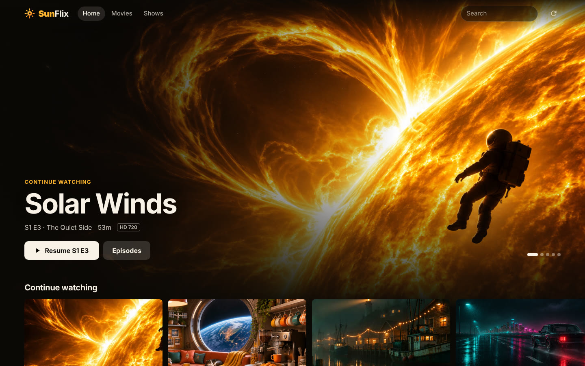
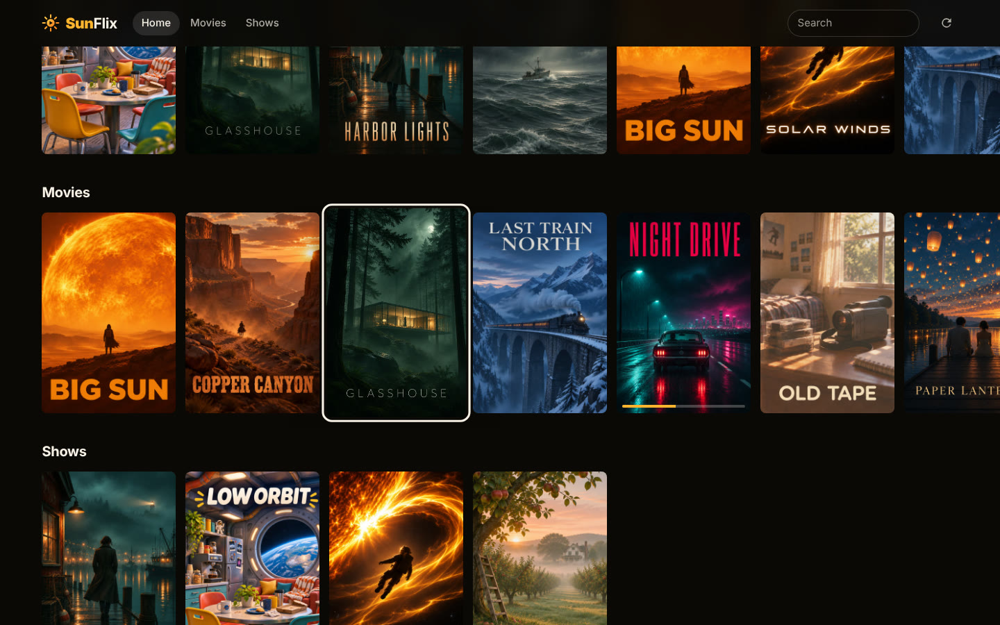

# SunFlix

Your own little streaming site. Point it at a folder of videos and it gives you
a browsable library with a player, in the spirit of Jellyfin and Plex, but small
enough to read in one sitting.





*The titles and artwork in these screenshots are made up for the demo.*

## Run it

You need [Node.js](https://nodejs.org) 18 or newer and [ffmpeg](https://ffmpeg.org)
(which includes `ffprobe`). There is nothing to `npm install`.

```bash
node server.js /path/to/movies /path/to/shows
```

Open <http://localhost:8787>. Other devices on your network can use
`http://<this-computer's-ip>:8787`.

With no folders given, SunFlix watches a `media/` folder next to `server.js`.

## What it does

- **Library** – finds videos in your folders, reads their length, resolution and
  tracks, and sorts them into movies and shows with seasons.
- **Plays anything ffmpeg can read** – files your browser understands are sent
  as they are. Everything else (MKV, HEVC, AC3, AVI…) is converted on the fly,
  and only re-encoded when it has to be.
- **Remembers where you stopped** – resume, watched marks, a Continue watching
  row, and the next episode queued up when you finish one.
- **Subtitles and audio tracks** – `.srt`/`.vtt`/`.ass` files next to the video
  and text subtitles inside it; switch audio language in the player.
- **Artwork** – uses `poster.jpg` and `backdrop.jpg` if they sit next to your
  files (in the movie's folder, or the show's folder). Without them it grabs a
  frame from the video and sets the title on it.
- **Built for the couch** – a full-screen spotlight of what to watch next, poster
  shelves, and arrow-key navigation between titles so a keyboard or remote is
  enough.
- **Search**, player shortcuts (space, ← →, F, M, Esc), phone-friendly layout.
- **Optional password** for the whole site.

## Naming your files

```
Movies/
  Big Sun (2021)/Big Sun (2021).mkv
  Night.Drive.2019.1080p.BluRay.x265.mkv
Shows/
  Solar Winds/
    Season 1/Solar Winds S01E01 - Dawn.mkv
    Season 2/03 - Flare.mkv
```

Movies want a title and ideally a year. Episodes want `S01E02` (or `1x02`)
in the name, or a number at the start of the name inside a `Season N` folder.
Subtitles go next to the video with the same name: `Big Sun (2021).en.srt`.

## Settings

All optional, set as environment variables.

| Variable | Default | What it does |
| --- | --- | --- |
| `PORT` | `8787` | Port to listen on |
| `HOST` | `0.0.0.0` | Address to listen on. Use `127.0.0.1` to keep it to this computer |
| `SUNFLIX_PASSWORD` | none | Require this password to browse or watch |
| `SUNFLIX_MEDIA` | `./media` | Media folders, separated by `:` (`;` on Windows). Same as passing them as arguments |
| `SUNFLIX_DATA` | `./data` | Where the library index, watch history and thumbnails are kept |
| `SUNFLIX_RESCAN_MINUTES` | `30` | How often to look for new files. `0` turns it off; the Rescan button always works |

```bash
SUNFLIX_PASSWORD=opensesame PORT=9000 node server.js /mnt/media
```

## Good to know

- **Without a password, anyone who can reach the port can watch.** That is fine
  on a home network. Before exposing SunFlix to the internet, set a password
  and put it behind an HTTPS reverse proxy (Caddy, nginx, Tailscale…), because
  SunFlix itself speaks plain HTTP.
- Converting video is heavy. A file marked *Transcode* needs a reasonably fast
  CPU per viewer; files marked *Remux* or unmarked cost almost nothing.
- Converted streams are tested in Chrome. Safari and iPhones are picky about
  this kind of stream, so files that need converting may not play there yet.
  Files that play directly (MP4 with H.264 and AAC) work everywhere.
- Picture-based subtitles (Blu-ray PGS, DVD) are not shown, only text ones.
- One watch history is shared by everyone; there are no separate profiles yet.
- Titles come from file names. Nothing is looked up online, so there are no
  plot summaries or cast lists.

## How it is put together

```
server.js        HTTP server, routes, login, watch history
lib/parse.js     file name -> movie / show / season / episode
lib/library.js   folder scan + ffprobe, cached in data/library.json
lib/media.js     ffmpeg: thumbnails, subtitle conversion, live transcoding
public/          the web app (plain HTML, CSS and JS, no build step)
test/            tests for the file name parser: npm test
```
